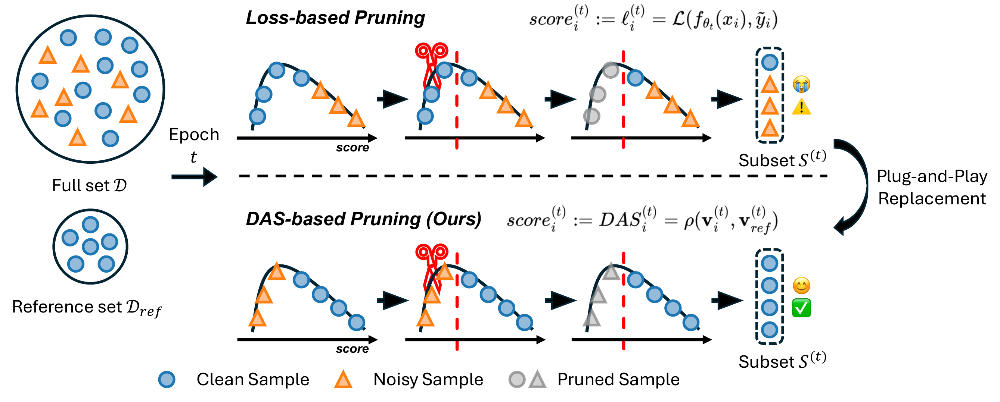

<div align="center">

# Beyond Loss Values: Robust Dynamic Pruning via Loss Trajectory Alignment

### CVPR 2026 Findings

Huaiyuan Qin<sup>1</sup>&nbsp;&nbsp; Muli Yang<sup>1</sup>&nbsp;&nbsp; Gabriel James Goenawan<sup>1</sup>&nbsp;&nbsp; Kai Wang<sup>2</sup>&nbsp;&nbsp; Zheng Wang<sup>3</sup>&nbsp;&nbsp; Peng Hu<sup>4</sup>&nbsp;&nbsp; Xi Peng<sup>4</sup>&nbsp;&nbsp; Hongyuan Zhu<sup>1</sup>

<sup>1</sup>Institute for Infocomm Research (I<sup>2</sup>R), A*STAR&nbsp;&nbsp;&nbsp;
<sup>2</sup>National University of Singapore&nbsp;&nbsp;&nbsp;
<sup>3</sup>Wuhan University&nbsp;&nbsp;&nbsp;
<sup>4</sup>Sichuan University

[](https://arxiv.org/abs/2604.07306)
[](https://arxiv.org/pdf/2604.07306)
[](LICENSE)



**Under label noise, rank samples by *how* their loss evolves, not by *how large* it is.**

</div>

Dynamic data pruning methods such as InfoBatch and SeTa rank the training samples by their loss and skip the
less informative ones during training. Under label noise this ranking is unreliable: noisy samples have large
losses, so they are kept or even prioritized. AlignPrune replaces the loss with the **Dynamic Alignment Score
(DAS)**, the Pearson correlation between the loss trajectory of a sample over the last N epochs and the
trajectory of the mean loss of a small clean reference set. The loss of a clean sample decreases like the loss
of the reference set, the loss of a noisy sample does not. AlignPrune only changes the ranking score: the
pruning rule and the loss rescaling of the base method, the model and the training loop stay the same.

This repository contains a minimal implementation of AlignPrune on CIFAR-10N and CIFAR-100N:

* `alignprune/`: the plug-and-play module, i.e. AlignPrune on top of InfoBatch (`AlignPrune`) and SeTa
  (`AlignPruneSeTa`), together with the base methods (`InfoBatch`, `SeTa`) and static random pruning (`StaticRandom`),
* `main_cifar.py`: training of a ResNet-18 on CIFAR-10N / CIFAR-100N with real (human) or synthetic label noise.

The code is a cleaned-up version of our research code, so results can differ slightly from the numbers in the paper.

## Installation

```bash
conda env create -f environment.yml
conda activate alignprune
```

The code needs PyTorch 2.3 or later and scikit-learn (for the k-means of SeTa).

## Data

CIFAR-10 / CIFAR-100 (python version) and the CIFAR-N label files of
[Wei et al.](https://github.com/UCSC-REAL/cifar-10-100n) in one folder:

```
data/
├── cifar-10-batches-py/
├── cifar-100-python/
├── CIFAR-10_human.pt
└── CIFAR-100_human.pt
```

```bash
mkdir -p data
wget -P data https://raw.githubusercontent.com/UCSC-REAL/cifar-10-100n/main/data/CIFAR-10_human.pt
wget -P data https://raw.githubusercontent.com/UCSC-REAL/cifar-10-100n/main/data/CIFAR-100_human.pt
python -c "from torchvision.datasets import CIFAR10, CIFAR100; CIFAR10('data', download=True); CIFAR100('data', download=True)"
```

| `--noise_type` | `--dataset` | label noise |
|---|---|---|
| `clean` | both | none |
| `real` | `cifar100` | CIFAR-100N human annotations (40.2% noise) |
| `aggre`, `worst` | `cifar10` | CIFAR-10N human annotations, aggregate (9.0%) and worst (40.2%) labels |
| `rand1`, `rand2`, `rand3` | `cifar10` | CIFAR-10N human annotations of a single annotator (17-18%) |
| `sym` | both | symmetric: a fraction `--noise_rate` of the labels is changed to one of the other classes, uniformly |
| `asym` | both | asymmetric: a fraction `--noise_rate` of the labels is changed to a similar class (CIFAR-10: airplane-bird, automobile-truck, cat-dog, deer-horse, frog-ship; CIFAR-100: a class of the same superclass) |

AlignPrune needs a small clean reference set. `main_cifar.py` holds out `--ref_size` (default 1,000) random
training images with their clean labels as the reference set. They are removed from the training set of every
method, so all methods train on the same images. As shown in the paper, a very small reference set is enough.

## Usage

AlignPrune wraps the training set and draws the training subset of every epoch through its sampler:

```python
from alignprune import AlignPrune  # or AlignPruneSeTa

trainset = AlignPrune(trainset, num_epochs, prune_ratio=0.5, window_size=25)
loader = DataLoader(trainset, sampler=trainset.sampler, batch_size=128)
criterion = nn.CrossEntropyLoss(reduction='none')

for epoch in range(num_epochs):
    for images, targets in loader:
        loss = criterion(model(images), targets)  # per-sample losses
        loss = trainset.update(loss, epoch)       # records the losses, returns the rescaled mean loss
        optimizer.zero_grad()
        loss.backward()
        optimizer.step()
    ref_loss = mean_loss(model, ref_loader)       # mean loss on the clean reference set
    trainset.update_reference(ref_loss, epoch)    # computes the DAS of the samples trained in this epoch
```

The wrapper returns `(index, sample)` pairs. As in InfoBatch, importing `alignprune` adds a hook to PyTorch's
data loader iterator that removes the indices from the batches and passes them to the wrapper, so the training
loop receives the usual `(images, targets)` batches. The number of iterations changes from epoch to epoch, so
the learning rate schedule should be a function of the training progress (see `util/lr_sched.py`).
With `torchrun`, `trainset.sampler` shards the subset across the processes, and `update()` gathers the
losses of all processes.

## Training

All commands use one machine with 2 GPUs and a batch size of 128 per GPU. The recipe follows InfoBatch:
ResNet-18, 200 epochs for full-data training, LARS with a one-cycle schedule (peak learning rate 5.2 on
CIFAR-100N, 5.62 on CIFAR-10N), weight decay 5e-4, label smoothing 0.1 and mixed precision.

**AlignPrune + InfoBatch** (`scripts/alignprune_infobatch.sh`)

```bash
torchrun --nproc_per_node=2 main_cifar.py \
    --dataset cifar100 --data_path ./data --noise_type real \
    --prune_type alignprune --prune_ratio 0.5 --window_size 25 --score pearson \
    --epochs 125 --batch_size 128 --optimizer lars --max_lr 5.2 --amp \
    --output_dir ./output_dir/alignprune_cifar100_real
```

**AlignPrune + SeTa** (`scripts/alignprune_seta.sh`)

```bash
torchrun --nproc_per_node=2 main_cifar.py \
    --dataset cifar100 --data_path ./data --noise_type real \
    --prune_type alignprune_seta --prune_ratio 0.1 --num_group 5 --window_scale 0.9 --window_size 25 --score pearson \
    --epochs 124 --batch_size 128 --optimizer lars --max_lr 5.2 --amp \
    --output_dir ./output_dir/alignprune_seta_cifar100_real
```

**Baselines** (`scripts/baselines.sh`): full-data training, static and dynamic random pruning, InfoBatch and SeTa,
e.g. `METHOD=infobatch bash scripts/baselines.sh`.

Synthetic noise, e.g. `--noise_type sym --noise_rate 0.5`, and CIFAR-10N, e.g.
`--dataset cifar10 --noise_type worst --max_lr 5.62`, use the same commands.

**Pruning ratio.** As in InfoBatch, the pruning ratio is the fraction of the forward passes of full-data
training (200 epochs) that is saved, and a dynamic method reaches a target ratio by training for fewer
epochs. `main_cifar.py` prints the reached ratio at the end of training; it depends a little on the noise.
Number of epochs on CIFAR-100N (approximate):

| method | ~30% | ~50% | ~70% |
|---|---|---|---|
| InfoBatch (`--prune_type infobatch`) | 196 | 140 | 84 |
| SeTa (`--prune_type seta`) | 204 | 146 | 87 |
| AlignPrune + InfoBatch (`--prune_type alignprune`) | 175 | 125 | 75 |
| AlignPrune + SeTa (`--prune_type alignprune_seta`) | 174 | 124 | 75 |

Static (`--prune_type static`) and dynamic (`--prune_type random`) random pruning train for 200 epochs with
`--prune_ratio` 0.3, 0.5 or 0.7.

**Hyper-parameters**

| | argument | default |
|---|---|---|
| pruning probability r | `--prune_ratio` | 0.5 with InfoBatch, 0.1 with SeTa |
| annealing ratio δ | `--delta` | 0.875 |
| trajectory window size N | `--window_size` | 25 |
| correlation function ρ | `--score` | `pearson` (also `cosine`, `dtw`) |
| SeTa: number of groups k, window scale α | `--num_group`, `--window_scale` | 5, 0.9 |
| size of the reference set | `--ref_size` | 1000 |

## Citation

```bibtex
@inproceedings{qin2026beyond,
  title     = {Beyond Loss Values: Robust Dynamic Pruning via Loss Trajectory Alignment},
  author    = {Qin, Huaiyuan and Yang, Muli and Goenawan, Gabriel James and Wang, Kai and Wang, Zheng and Hu, Peng and Peng, Xi and Zhu, Hongyuan},
  booktitle = {Proceedings of the IEEE/CVF Conference on Computer Vision and Pattern Recognition (CVPR) Findings},
  month     = {June},
  year      = {2026},
  pages     = {3029-3039}
}

@inproceedings{qin2024infobatch,
  title     = {InfoBatch: Lossless Training Speed Up by Unbiased Dynamic Data Pruning},
  author    = {Qin, Ziheng and Wang, Kai and Zheng, Zangwei and Gu, Jianyang and Peng, Xiangyu and Xu, Zhaopan and Zhou, Daquan and Shang, Lei and Sun, Baigui and Xie, Xuansong and You, Yang},
  booktitle = {International Conference on Learning Representations (ICLR)},
  year      = {2024}
}

@inproceedings{zhou2025scale,
  title     = {Scale Efficient Training for Large Datasets},
  author    = {Zhou, Qing and Gao, Junyu and Wang, Qi},
  booktitle = {Proceedings of the IEEE/CVF Conference on Computer Vision and Pattern Recognition (CVPR)},
  year      = {2025}
}
```

## Acknowledgements and license

This code is built on the code of [InfoBatch](https://github.com/NUS-HPC-AI-Lab/InfoBatch) and
[SeTa](https://github.com/mrazhou/SeTa). The ResNet is adapted from
[pytorch-cifar](https://github.com/kuangliu/pytorch-cifar), and the CIFAR-N labels are from
[CIFAR-N](https://github.com/UCSC-REAL/cifar-10-100n).

This project is released under the CC BY-NC 4.0 license. See [LICENSE](LICENSE) for details.
